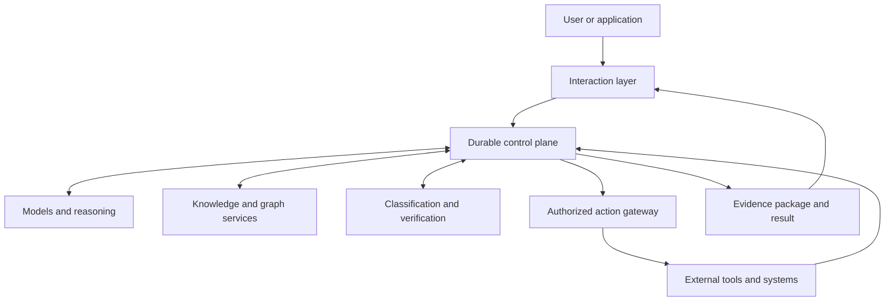
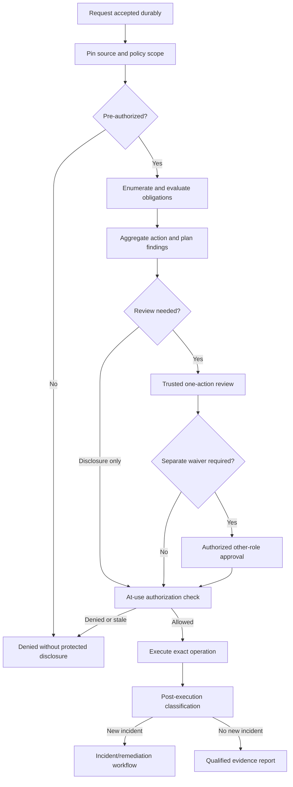
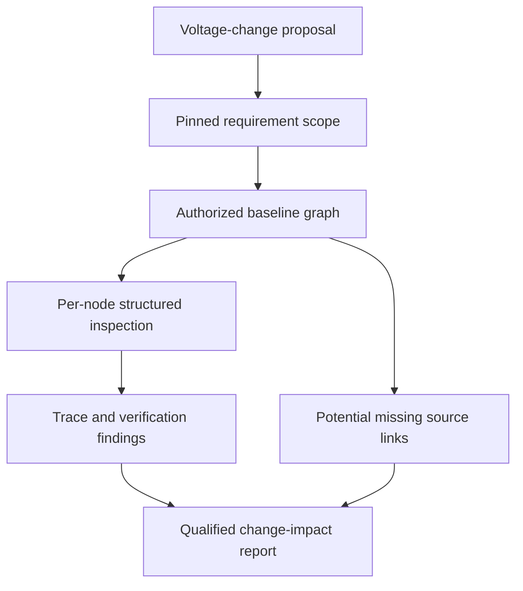

# Evidence-Gated Agentic Systems

*Independent research by Corey Steinwand · Working white paper v0.1 · November 2026*

> **Research draft, not a product, certification claim, or peer-reviewed result.** The SysML companion is an architectural and verification proposal. Syntax parsing is not execution of its proposed tests. All performance, safety, and business benefits remain unproven.

## Executive summary

Probabilistic agents can produce plausible engineering reports without examining the required evidence or understanding the limitations of their source models. The proposed architecture separates model reasoning from deterministic control-plane duties: scope selection, access control, workflow persistence, obligation enumeration, evidence provenance, tool authorization, and audit.

The central contribution under investigation is **a bounded verification contract**. Before an agent reports complete coverage of a defined task, a deterministic mechanism checks the frozen *authorized* graph, the roots and scope approved outside the model, and structured inspection results for each required node and applicable relationship. It records missing work, extra exploration, source gaps, budget exhaustion, and claims that could not be established.

**The critical limitation is source completeness.** A checker can show that an agent examined all modeled dependencies while real engineering dependencies remain absent. The research therefore begins with a no-LLM historical-escape study and compares existing MBSE tools, deterministic graph queries, Codex-style agents, managed agents, and a thin verifier before considering a new harness.

The design also explores exact-action risk acknowledgements, mandatory separate-role waivers, deterministic taint propagation, trusted consent rendering, plan-level effect checks, and concise evidence-labeled reports. These are proposed contracts, not claims of unique invention. Existing approaches—including FIDES, provenance standards, assurance cases, and established MBSE/ALM platforms—are material prior art.

# 1. Problem Definition and Intended Scope

## 1.1 A plausible answer is not a complete investigation

In MBSE, a small change may propagate across requirements, functional decompositions, physical components, interfaces, constraints, and tests. A model that retrieves three plausible dependencies may omit the fourth. If that omission is hidden in a fluent summary, the answer can mislead reviewers.

This is not solely an LLM problem. Engineering organizations already invest in requirements traceability, review, verification, and change-impact analysis. The proposed harness makes those obligations explicit when probabilistic models participate in the workflow. NASA's [systems engineering guidance](https://www.nasa.gov/reference/2-0-fundamentals-of-systems-engineering/) identifies requirements allocation, interfaces, design tradeoffs, and verification as central activities.

## 1.2 Goals

- Prevent a model's internal judgment from becoming operational authority.

- Make evidence provenance, coverage, and uncertainty visible.

- Run applicable classifications and validations comprehensively, not until the first issue.

- Present all findings for an individual action in a single, explainable review package.

- Prove scoped graph traversal accounting through deterministic checks.

- Challenge graph results with alternate queries or independent sources.

- Apply comparable engineering patterns and versioned, user-maintained use-case instructions.

- Make operations durable, cancellable, recoverable, attributable, and measurable.

- Integrate with existing engineering and agent technologies rather than require their replacement.

## 1.3 Non-goals

This system is **not** a universal truth oracle, a replacement for qualified professional responsibility, or a guarantee of zero hallucinations. It cannot prove that an incomplete external dataset contains every relevant real-world fact. Nor does it guarantee constant-time graph reachability. It does not need to recreate an LLM, graph store, requirements manager, or durable workflow engine merely because those components appear in one reference implementation.

# 2. Governing Philosophy and Trust Boundaries

## 2.1 Foundational principles

| Principle | Architectural consequence |
|:--|:--|
| Models reason; the harness governs | Generated plans, actions, and answers are proposals. |
| Authority is explicit | Identity, tenant scope, and permissions are verified independently. |
| Evidence precedes factual authority | Claims retain sources, derivations, and epistemic status. |
| Uncertainty is an acceptable outcome | Inconclusive, stale, and missing evidence must be disclosed. |
| Detection and enforcement are separate | Classifiers produce findings; authorization enforces privileges. |
| Actions are attributable | Reviewed inputs, consent, execution, and outcomes are traceable. |
| Knowledge is not silently promoted | Hypotheses do not become canonical facts by repetition. |
| Technology is replaceable | Responsibilities are defined before vendors or libraries. |

## 2.2 Two dimensions of trust

**Authority** asks whether an actor or component may direct or perform an operation. **Evidence quality** asks how well supported a factual claim is. An authorized engineer can be mistaken; an external document can be accurate but may not issue instructions; a formal solver can verify a property without granting permission to act. These dimensions must not collapse into one confidence score.

## 2.3 Six control boundaries

| Boundary | Governing rule |
|:--|:--|
| User → harness | Interpret intent but independently establish permissions. |
| External sources → reasoning | Treat retrieved text and tool outputs as evidence candidates, never as system instructions. |
| Model → control plane | Normalize outputs into nonauthoritative proposals. |
| Control plane → tools | Check exact action, actor, resource, policy, and consent at execution time. |
| Reasoning → memory | Retain provenance, uncertainty, and validation status. |
| Generated output → user | Ground claims and label unresolved uncertainty. |

This is a defense-in-depth design; prompt injection and excessive agency remain material threats, as identified by [OWASP](https://genai.owasp.org/llm-top-10/).

# 3. Risk Acceptance, Waivers, and Authorization

Classifier findings and execution permissions are distinct. An actor may acknowledge any warning, including critical or intentionally dangerous risk; an acknowledgement cannot change their roles, grant access, alter factual status, or bypass source-system policy. Every acceptance is recorded as a disposition of a specific finding set for **one individual proposed action**.

A meaningful risk policy may impose a second condition: a **waiver by a different authorized role** or an external regulated approval. The initiating actor can still acknowledge the finding, but execution remains unavailable until independent waiver and ordinary authorization requirements are met. The system must not conflate a person's willingness to accept risk with their authority to accept it for the organization.

The control plane first performs an authorization and visibility **pre-check**. If the actor cannot access the requested operation or source, it can deny immediately without performing sensitive checks or revealing private findings. After analysis and review, the tool gateway performs a separate current authorization check against the exact actor, resource, operation, and arguments.

## 3.1 One review packet per individual action

For each consequence-bearing action, the harness assembles **all currently evaluable findings into one trusted review packet**. It deduplicates but retains divergent results, shows severity and source evidence, identifies checks not run, and binds the packet to canonical action and finding-set digests. One explicit acknowledgement can cover those findings for that one action. Reuse, meaningful argument changes, target changes, and updated findings invalidate it.

The **consent interface is rendered by trusted code**, not by model-authored instructions or unescaped retrieved text. A prompt injection embedded in a finding's explanation must never alter the displayed operation or approval target. Disclosures are filtered for the reviewing actor's permission scope.

A qualified **read-only answer** need not always require an acknowledgement click: policy may permit publication with clear uncertainty disclosure. Read-only outputs can still affect engineering decisions, so they are evaluated for misleading confidence and automation bias.

## 3.2 Plan-level and post-execution risks

An individual-action policy cannot detect every combined effect. A read followed by an external post, or many small edits that cumulatively cross a safety threshold, requires **plan-level and batch-level risk assessment** in addition to per-action disposition.

Tool-result findings discovered *after* an action executes cannot be retroactively acknowledged as if they preceded it. They must lead to updated downstream decisions, incident handling, containment, or remediation as applicable.

A model's disagreement with a classifier may be recorded as counterevidence; it cannot overrule the deterministic authorization boundary.

# 4. Logical Architecture



This diagram describes logical responsibilities, not separate deployable services.

| Responsibility | Owner |
|:--|:--|
| Immediate conversation and progress | Interaction layer |
| Checkpoints, transitions, retries, budgets, cancellation | Durable control plane |
| Context sufficiency, planning, interpretation, synthesis | Model roles |
| Canonical documents, graph edges, source metadata | Knowledge services |
| Risk detection, formal checks, coverage, grounding | Verification services |
| Identity, action policy, approvals, tool execution | Action gateway |
| Memory projections, audit trail, metrics | Persistence and observability services |

## 4.1 Model roles

A small context assessor may advise whether evidence is sufficient, additional retrieval is needed, or clarification is required. Larger or specialized reasoning models may develop plans and synthesize answers. Separate critics can identify contradictions and missing support. These are logical roles, not a mandated number of agents or model calls. A model's declaration of sufficiency or completion is never the sole basis for treating an execution as complete.

## 4.2 Model disagreement

When models disagree, evidence and deterministic rules take precedence over model preference. More model votes do not establish truth when all participants rely on the same incomplete source. The harness may gather additional evidence, report a dispute, or ask for clarification.

# 5. Durable Execution and Action Lifecycle

A **conversation** is an interaction; a **work execution** is a durable request; a **proposed action** is an individually identified operation; a **finding** is a normalized observation; and an **evidence packet** is a reportable record of sources, checks, and limitations.



An immediate conversational reply follows durable acceptance; work continues asynchronously with checkpoints and cancellation, retries, and recovery. [Temporal](https://docs.temporal.io/workflow-execution) and existing agent workflow engines are candidates for reuse.

## 5.1 Aggregate findings, with explicit exceptions

Once the pre-check permits inspection, independently evaluable deterministic and semantic checks run within declared budgets. Findings are presented together per action, rather than first-failure-by-first-failure. A permission denial is a legitimate early short-circuit because further inspection may itself expose protected information.

Five inspection boundaries exist: incoming request, retrieved source, proposed action, tool result, and generated report. Checks at a boundary that has not yet occurred remain **not evaluated**; the system never promises foreknowledge of later outputs.

## 5.2 Resource limits and visibility

Budgets include nodes, edges, model calls, classifier calls, tokens, wall time, latency, and external effects. Dense closure and repeated classifications can consume substantial resources. Exhaustion must result in **incomplete or inconclusive** findings with privately recorded outstanding obligations; it must not yield an apparently clean coverage badge.

Graph completeness is always relative to the **authorized view**. Different users may receive different valid scoped assessments. No inaccessible node identities or hidden inventory counts may leak through summary metrics.

## 5.3 Stale data and action invalidation

When a source baseline, policy, permission, finding set, action argument, or relevant resource version changes, the previous review decision may be invalid. The control plane rechecks before execution and reports stale or inconclusive results when a safe replay cannot be justified.

# 6. Graph Semantics, Coverage, and Source Fidelity

A graph represents typed engineering entities and modeled relationships. It can be stored in relational tables, RDF, a graph database, or another authoritative model store. Retrieval of plausible neighbors and verification of graph closure are different tasks.

## 6.1 Exact graph queries before probabilistic inference

Semantic search and hyperbolic embeddings may help locate candidate contexts, but they do not establish exact directed reachability. Poincaré embeddings describe hierarchical similarity; they do not turn exhaustive multi-hop traversal into constant time. Exact closure using [PostgreSQL recursive queries](https://www.postgresql.org/docs/18/queries-with.html) or established graph query tools is an essential baseline.

## 6.2 The control-plane-pinned traversal contract

The actor and an approved domain profile establish an explicit, versioned contract: *root entity identifiers, relevant edge types and directions, exclusions, leaf/stopping rules, source snapshot, visibility scope, and work budget*. A language model may suggest roots and relations, but it **cannot silently ratify its own selection**. A wrong root or narrower scope produces a finding.

Let `R(G,r,S)` be required reachable nodes of snapshot `G` under approved roots `r` and scope `S`. Let `V` be inspected nodes. The relevant membership condition is:

```
R(G,r,S) ⊆ V
```

Additional visits `V \ R` are allowed but **must be disclosed and permission-checked**. Every applicable modeled edge and required terminal leaf must also be accounted for. Strict set equality is inappropriate when legitimate out-of-scope exploration occurs.

Crucially, **“accounted for” means more than mentioning an identifier**. The deterministic harness can enumerate the required nodes itself and supply them individually to the reasoning worker. Each must receive a structured, source-version-bound disposition (finding, evidence, checked obligations, and unresolved questions), with independent validation of schema and evidence references. A copied ID list does not pass.

A result may be described as **verified under the declared graph contract** only if authorized inventory and baseline are known, pinned scope is confirmed, required structured inspections pass, applicable edges and leaves are handled, excess visits are reported, outstanding obligations are disclosed, and the budget has not truncated the run.

## 6.3 The missing-edge problem

A perfectly traversed graph can omit a real dependency because the trace link was never modeled, was modeled incorrectly, or was withheld from the source inventory. This is likely a more consequential failure class than merely failing to visit a known node.

A traversal receipt **cannot detect absent source relationships by itself**. Independent engineering inventories, interface artifacts, model-quality checks, known hazards, domain patterns, or historical escape records may provide evidence of missing links, but they are not universally available. A second algorithm over the same incomplete extraction cannot establish that the source is complete.

This limitation is a central falsification target, not a minor footnote. Section 16 begins with a no-LLM study of 20–30 historical engineering escapes classified against graphs as they existed at the time.

## 6.4 Boundaries of the assurance claim

The receipt says **which bounded work obligations were checked**. It does not prove natural-language truth, an agent's internal comprehension, universal engineering completeness, or the safety of a future decision. If a contract is stale, permission-restricted, budget-exhausted, or contradicted, coverage status remains qualified or incomplete. No percentage badge can erase these limits.

# 7. Corroboration, Sibling Models, and Domain Profiles

## 7.1 Independent methods versus independent sources

A separately implemented query, reverse relation walk, or alternative algorithm can challenge **method correctness**. It does not automatically challenge **source completeness** if both methods use the same missing-edge extraction. An independent data lineage can provide stronger evidence, but many MBSE tasks have only one authoritative engineering model.

Corroboration receipts must therefore distinguish: (a) methodological independence, (b) source-data independence, (c) agreement, (d) disagreements, and (e) unavailable alternatives. The absence of a genuinely separate source is a **limitation**, not automatic project failure or a permanently qualified badge for every run.

## 7.2 Sibling-subgraph comparison

Comparable peer systems can reveal unusual omissions, inconsistent allocations, or unexpected test coverage. A specialized profile records selection rules, equivalence criteria, baseline, and expected relationships. Differences are findings for engineering review—not automatic requirements to normalize architecture.

Sibling models may share the same institutional error. A comparison must never turn repeated mistakes into authoritative patterns. If meaningful peers do not exist, the check is marked not applicable or unavailable, not fabricated.

## 7.3 User-maintained reasoning profiles

Domain owners maintain versioned, access-controlled prompts, rule sets, reference patterns, and report requirements. Prompts are reasoning aids and cannot modify the pinned root/scope contract, erase findings, grant tool permissions, or upgrade data integrity labels.

The benefits of sibling comparisons, independent challenge methods, and domain prompts remain research hypotheses to be measured against deterministic and human baselines.

# 8. Evidence Status and Bounded Reports

Every substantive claim carries an explicit status, not a single undifferentiated confidence score:

| Status | Meaning |
|:--|:--|
| Verified under contract | Specific deterministic checks passed against named inputs, rules, and assumptions. |
| Supported | Authoritative sources directly support the bounded claim; no universal proof is implied. |
| Inferred | The conclusion extends beyond established source evidence. |
| Contradicted | Available evidence directly conflicts with the claim. |
| Unknown | Required evidence was not available or not established. |
| Stale | Input or evidence is no longer current under the source freshness policy. |
| Inconclusive | Evaluation stopped, timed out, exhausted budget, or produced an indeterminate result. |
| Disputed | Competent evidence sources or reviewers disagree and no resolution has been validated. |

Claim extraction from model-generated prose is itself probabilistic. Checking only extracted claims can miss important obligations that the answer **never mentioned**. The harness therefore compares the report against a separate, trusted inventory of required answers and outstanding graph inspections. Missing claims and unanswered obligations are surfaced explicitly.

## 8.1 Inspectable evidence package

The proposed package records the authorized source snapshot; pinned traversal contract; independently verified per-node dispositions; required and additional graph visits; source-quality and missing-link limitations; conditional independent queries and sibling comparisons; claim-to-source and claim-to-obligation mappings; solver outcomes; policy and waiver decisions; final findings; and unrun checks.

Claims of **cryptographic attestation** require actual signature verification over a canonical payload with signer identity and provenance. Plain JSON, a hash, or a model-authored claim is not proof of tamper-evident process execution. Applicable prior art includes [W3C PROV](https://www.w3.org/TR/prov-o/), [in-toto](https://in-toto.io/docs/specs/), and [SLSA provenance](https://slsa.dev/spec/v1.2/provenance).

## 8.2 Separate assurance questions

- *What did the workflow execute?* Durable logs and authenticated tool outcomes.
- *What modeled evidence was examined?* Pinned graph contract and structured obligation receipts.
- *How accurate was the source model?* External reconciliation, model-quality checks, and known unknown links.
- *Which reported claims are supported?* Verified provenance, factual applicability, and unspoken obligation inventory.
- *Which formal predicates passed?* Correctly encoded constraints and assumptions.
- *How did the report influence the human reviewer?* Evaluation of automation bias, not just report readability.

Passing one check never silently upgrades another assurance dimension.

# 9. Constraint Checking and Solver Semantics

Use direct deterministic comparisons when sufficient—for example, evaluating `60 V > 48 V` requires no SMT solver. A solver such as [Z3](https://microsoft.github.io/z3guide/programming/Z3%20Python/Introduction/) is useful when numerous encoded constraints interact, especially around satisfiability, logical combinations, and counterexamples.

The output contract distinguishes **SAT** (a satisfying assignment exists under the encoding), **UNSAT** (no assignment exists under that encoding), **UNKNOWN** (the solver cannot establish either), **TIMEOUT** (evaluation was interrupted by the budget), and **NOT RUN**. None is equivalent to universal proof of physical safety, correct requirements translation, or legal authorization.

Tool evidence includes solver version, constraint bundle, assumptions, exact variables, graph/source baseline, and any witness or unresolved reason. LLM-generated constraints are untrusted until their interpretation has been independently checked. Solver results cannot silently repair incorrectly modeled requirements.

# 10. Tool Authorization, Data Labels, and Consent Integrity

A model may propose a tool call but cannot authorize it. The control plane resolves the actor, tenant, operation, resource, exact arguments, policy, source visibility, and expected side effects **before sensitive evaluation**; a second check occurs at actual use.

An acknowledgment covers all disclosed findings for one exact proposed action and may be accepted despite severity. It never mutates permission state, waives obligations assigned to a different role, erases a constraint violation, or makes an unavailable operation executable. A required different-role waiver is a separate policy artifact, and a plan-level approval cannot replace the individual action acknowledgment.

External documents, retrieved text, tool results, and generated explanations retain **deterministic integrity and confidentiality labels** as they propagate. Probabilistic classifiers may raise findings but never upgrade an untrusted source to trusted authority. An untrusted instruction embedded in a risk explanation cannot alter the consent UI: the operation, target, and exact arguments are rendered from canonical control-plane fields.

Microsoft's experimental [FIDES security model](https://learn.microsoft.com/en-us/agent-framework/agents/security) is material prior art for label propagation and exact-invocation approval. Its presence reduces any claim that these mechanisms are novel. Tool-side permissions and source access remain mandatory even after a person acknowledges danger.

No approval token alone removes time-of-check/time-of-use races. Version checks, idempotency, atomic consumption, audit trails, and source-system enforcement are separate requirements.

# 11. Knowledge Integrity, Memory, and Synchronization

The harness needs an authoritative record of user inputs, actions, findings, approvals, source versions, and accepted knowledge changes. Semantic embeddings, graph indices, and reporting views may be **projections** of that record rather than independent sources of authority.

A transactional outbox allows a canonical state change and an event describing that change to commit together, with downstream projection workers applying the event later. This is different from a Conflict-free Replicated Data Type (CRDT). CRDTs are appropriate when independently writable replicas must converge under a specified merge rule; they are not required merely to synchronize database projections. [Microsoft's transactional outbox guidance](https://learn.microsoft.com/en-us/azure/architecture/databases/guide/transactional-out-box-cosmos) describes the core pattern.

## 11.1 Staleness is a query property

The system must know which canonical version each projection represents. If a required projection lags, the harness can wait for it, route an exact query to an authoritative store, or report that the analysis cannot be certified. A fallback text search is **not** an equivalent substitute for exact graph reachability.

## 11.2 Memory promotion policy

Distinguish what the user asserted, what a source reported, what a model inferred, what formal checks established, and what a person approved. Keep provenance and version on reuse. Unsupported model conclusions must not silently become canonical engineering facts or new governing policies.

# 12. Threat Model and Failure Modes

| Failure or attack | Required response |
|:--|:--|
| Prompt injection in sources or review text | Deterministic taint labels, trusted rendering, explicit data/instruction boundary. |
| Unauthorized source requested | Pre-review denial, source-visibility filtering, no hidden counts. |
| Wrong root or narrowed graph scope | Control-plane/profile pinned contract; mismatch is a finding. |
| Agent echoes node IDs without analysis | Harness enumerates obligations; requires source-bound structured dispositions. |
| Missing relationship in authoritative model | External model-quality checks, historical escapes, explicit unknown-source limitation. |
| Correlated corroborators | Separate method/source claims; record shared lineage. |
| Reviewer rubber-stamps critical findings | Plan-level review, distinct policy waiver where required, automation-bias measurement. |
| Single actions safe but sequence harmful | Composite-effects classification for read/post and bulk changes. |
| Changed tool arguments or source version | Recheck exact action, policy and input baseline at execution. |
| Finding appears after execution | Incident and remediation flow; no retroactive consent fiction. |
| Budget exhaustion or dense closure | Incomplete/inconclusive status; preserve unfulfilled obligations privately. |
| Model-generated claims omit critical topics | Compare claim extraction against trusted obligation inventory. |
| Signed incorrect report | Integrity status remains separate from semantic correctness. |

No single model, classifier, solver, or validator can establish all these properties. Risk controls must correspond to the relevant component's actual authority.

**Automation bias is a first-class threat.** A read-only report can influence design sign-off, and a green coverage badge may reduce reviewer skepticism. Human studies should compare decisions with and without apparent verification indicators, including deliberately missing source links.

Security designs can draw on [OWASP's LLM risk taxonomy](https://genai.owasp.org/llm-top-10/), [CaMeL's data/control separation research](https://arxiv.org/abs/2503.18813), and [Microsoft FIDES](https://learn.microsoft.com/en-us/agent-framework/agents/security), while distinguishing proposals from measured defense coverage.

# 13. MBSE Reference Application: Engineering Change Impact

**Synthetic example, not a validated battery design:** An engineer asks, “What changes if the battery subsystem operating voltage increases from 48 V to 60 V?” This is a **read-only assessment request**, not authorization to edit a design baseline.



Possible known model relationships include controllers, battery-management functions, charger interfaces, wiring and protection, safety assumptions, requirements allocation, verification tests, and system interfaces. Whether each exists in the **actual** model cannot be assumed from domain knowledge or a generated diagram.

A controlled evaluation would:

1. Resolve the actor's source permissions and the authoritative frozen baseline.
2. Pin roots, relation types, and exclusions under a qualified profile or control-plane decision.
3. Enumerate all required modeled nodes, applicable edges, terminal obligations, and verification artifacts.
4. Require structured evidence-bearing inspection results for each required node, not an ID list.
5. Compare alternative queries and similar subsystems *only where suitable and possible*.
6. Check available external inventories for potential missing trace links.
7. Evaluate change-specific constraints and produce supported, inferred, stale, inconclusive, disputed, and unknown claims.
8. Deliver an authorized read-only report with limitations; require action-level acknowledgement and any independent waivers only for a later consequence-bearing operation.

The reference case's strongest claim would be bounded **reproducibility of an impact investigation**, not a guarantee that all physical consequences were discovered. The latter depends on engineering model quality and external evidence.

A practical early pilot should use existing requirements or MBSE infrastructure in shadow mode, avoiding replacement of the organization's source of truth.

# 14. Evaluation, Reviewer Behavior, and Net Economics

All advertised quality or economic benefits are hypotheses until tested against appropriate baselines. The research must distinguish coverage of known graph obligations from detection of omitted real-world dependencies.

## 14.1 Measurement dimensions

| Dimension | Evaluation measure |
|:--|:--|
| Historical escape recoverability | Present/reachable, present/out-of-scope, source-absent, indeterminate, using as-of baselines. |
| Deterministic coverage | Recall of required nodes, edges, leaves, and valid structured dispositions. |
| Missing-link detection | Precision and recall for omitted relation classes, with independent adjudication. |
| Report quality | Supported claim precision, omitted-obligation rate, unknown/stale/disputed labeling. |
| Independent challenge | Whether independent methods or data lineages actually identify correlated mistakes. |
| Findings and action integrity | False positives, reviewer burden, replay rejection, role-waiver correctness. |
| Human judgment | Unsafe sign-offs, critical misses, rubber-stamp behavior, and automation bias with versus without coverage badges. |
| Resource bounds | Latency, total graph work, model calls, timeouts, budget exhaustion, and permission-scoped leakage. |
| Full costs | Integration, maintenance, qualification, compute, incident handling, and added engineering review time. |

No target of 100% precision or universal reliability is asserted. The test protocol preregisters thresholds, baselines, expected sample sizes, and explicit stop conditions, reporting uncertainty intervals and sampling limitations.

## 14.2 Controlled comparisons

Begin with 20–30 archived engineering escapes **without an LLM**. Recover the engineering graph as of the event and determine which misses any complete traversal could have exposed. Do not backfill the model from facts learned after the escape.

If Phase 0 warrants continuation, compare: existing engineering workflow, deterministic graph/SQL baseline, an existing coding agent with the same query tools, a managed agent with an external verifier, a thin evidence-gate service, and the broader proposed harness. Each arm receives the same authorized source data and a comparable work budget. Independent reviewers score omissions, incorrect assurances, false positives, and labor.

A controlled reviewer trial should test whether displaying coverage indicators increases confidence in incomplete source graphs. This is not an optional user-experience detail; it is central to the safety argument.

## 14.3 Gross versus net value

A hypothetical organization with 500 changes per year, a 2% expensive-escape rate, $150,000 average avoidable cost, and a 30% early-detection improvement yields **$450,000 of gross assumed avoidance**. Those numbers are illustrative, not observed industry statistics or a commercial forecast.

If the new workflow adds four reviewer hours per change at $150 per hour, additional review labor is **$300,000 per year**. That leaves only $150,000 before integration, compute, infrastructure, maintenance, qualification, and disruption costs. Net value may therefore be zero or negative despite apparently impressive avoided rework.

The credible purchase argument is not “engineering errors are expensive,” but “this bounded, measured workflow reduces expected total cost and decision risk more than the cheapest adequate alternative.”

# 15. Prior Art, Tool Qualification, and the Actual Differentiation Question

The architecture combines mechanisms that already exist in several communities. It should not claim that action-bound approval, taint propagation, graph closure, provenance, or structured assurance cases are newly invented here.

| Precedent | Consequence for this research |
|:--|:--|
| [Microsoft FIDES](https://learn.microsoft.com/en-us/agent-framework/agents/security) | Experimental, currently Python-only, and already binds approvals to exact invocations while propagating integrity/confidentiality labels. Reuse or compare directly. |
| [W3C PROV-O](https://www.w3.org/TR/prov-o/), [in-toto](https://in-toto.io/docs/specs/), [SLSA 1.2](https://slsa.dev/spec/v1.2/) | Existing provenance and attestation models; signed bytes do not establish semantic truth. |
| [Goal Structuring Notation / assurance cases](https://www.goalstructuringnotation.info/) | Established safety argument patterns, context, assumptions, strategies, and evidence. |
| [FAA AC 20-115D / DO-178C and DO-330](https://www.faa.gov/airports/resources/advisory_circulars/index.cfm/go/document.information/documentNumber/20-115D) | Aviation tool-use and qualification requirements may be an early adoption barrier, not a later feature. |
| [ISO 26262](https://www.iso.org/) and [SAE ARP4754 family](https://www.sae.org/) | Sector-specific development assurance processes constrain how automated evidence may affect safety decisions. Applicability must be assessed by a qualified domain authority. |
| [OSLC specifications](https://open-services.net/specifications/) | Standard tool linking and lifecycle traceability already address many integration needs. |
| [Bohner and Arnold, *Software Change Impact Analysis*](https://www.wiley.com/) | Established change-impact analysis and over-approximation concerns predate agentic workflows. |
| [CaMeL](https://arxiv.org/abs/2503.18813) | Research on defeating prompt injection through design-level separation of untrusted content and executable authority. |
| [PTC Codebeamer](https://www.ptc.com/en/products/codebeamer), [Jama Connect](https://www.jamasoftware.com/solutions/requirements-traceability/), [Ansys SAM](https://ansys.synopsys.com/products/connect/ansys-system-architecture-modeler) | Commercial systems already support traceability, impact assessment, AI assistance, or SysML v2 integration. Their capabilities must be measured, not ignored. |

The proposed differentiation, if validated, is a **portable, contract-bound method for verifying the completeness and evidentiary limits of an agent-assisted investigation across existing tools**—not a new LLM platform for its own sake.

The prior-art comparison asks: **Could deterministic graph queries plus a thin verifier, Codex with scoped tooling, or managed agents achieve the same outcomes at lower cost?** If yes, the broad harness should not be built.

Medical evidence-graph research and systematic review practices provide useful analogies, but graph-assisted retrieval during model training is not a runtime completeness gate; LLM-based adversarial judges are not deterministic verifiers. Sources and claims must be described with their actual scope.

For safety-critical buyers, tool qualification and an evidence-based assurance case are potential prerequisites. This working paper does not claim compliance with DO-330, ISO 26262, ARP4754, or any certification scheme.

# 16. Falsifiable Research Roadmap and Kill Criteria

The smallest useful study begins before implementing a language-model harness.

**Phase 0 — Historical escape classification, no LLM.** Select 20–30 historical engineering escapes under a declared sampling protocol. Recover each engineering model as it existed at the time. Classify whether the critical dependency was (a) present/reachable under approved scope, (b) present but out of scope, (c) absent from the model, or (d) indeterminate. Obtain independent adjudication where evidence conflicts. This determines whether complete graph traversal could plausibly have prevented the failure at all.

**Decision gate — Build, buy, or compose.** Test ordinary MBSE/ALM impact queries, deterministic graph validation, coding agents with scoped tools, managed agents, and a thin verifier. Evaluate real permission, provenance, tool-qualification, integration, and maintenance constraints. Select a custom harness only if alternatives fail measured criteria.

**Phase 1 — Deterministic reference experiment.** Implement control-plane-pinned scope, node/edge/leaf obligation enumeration, structured inspection results, missing-source limitation reporting, and budget-based inconclusive outcomes against synthetic and historical graphs. Publish reproducible tests for wrong roots, omitted nodes, absent edges, cycles, fan-out, permission filters, and false-pass attempts.

**Phase 2 — Bounded model assistance.** Integrate a probabilistic reasoning worker using the same enumerated obligations. Compare claim extraction and omissions to trusted inventory, measure value added over deterministic-only baselines, and challenge prompt injection and taint propagation.

**Phase 3 — Human decision experiment.** Evaluate one-action findings, read-only uncertainty disclosure, plan-level composite effects, different-role waivers, and reviewer complacency. Record how much reviewer time the method adds.

**Phase 4 — Shadow pilot.** If earlier gates pass, run read-only alongside one existing engineering workflow. Avoid autonomous design sign-off or write actions until authorization, source fidelity, independent review, and applicable qualification questions are addressed.

**Kill or reframe when:** historical escapes predominantly depend on unmodeled data with no recoverable external evidence; the method offers no material benefit over a thin deterministic baseline; reviewer errors increase; incremental costs exceed plausible avoided losses; or a buyer's qualification and integration burden is disproportionate. Exact thresholds should be preregistered with real users rather than chosen to flatter results.

These phases are research tests, not a product delivery schedule.

# 17. Decision Record and Open Research Questions

## 17.1 Proposed architectural invariants

These are design constraints for the **proposed** system, selected by the independent researcher and still subject to review—not findings validated by an external standards body.

- Deterministic authority governs permissions, execution, state, evidence labels, and audit.
- Risk acknowledgement remains possible for every classifier severity but never grants permissions or replaces a policy-required different-role waiver.
- One acknowledgement applies to one exact executable action and its presented set of currently evaluable findings.
- Preauthorization may deny before sensitive evaluation. Authorized passes aggregate findings without first-warning short-circuiting inside the declared budget.
- Pinned roots/scope and harness-enumerated structured node inspection are prerequisites to a graph-coverage claim.
- Graph coverage can be verified only against a known authorized snapshot. It does not prove missing real-world links are absent.
- Source taint propagates deterministically; classifiers do not promote trust.
- Generated consent text never determines the actual action the user approves; plans and action sequences receive separate composite-effects review.
- Stale, hidden, budget-exhausted, disputed, and inconclusive evidence must remain visible as limitations without leaking protected content.

## 17.2 Decisions still requiring empirical or policy review

- Which engineering datasets establish source completeness when no independent authoritative source exists.
- When sibling comparisons apply, how comparable cohorts are chosen, and what constitutes justified novelty.
- Which reviewers are authorized for waiver classes or regulated approvals.
- How to verify the semantic sufficiency of each node's structured disposition beyond a schema check.
- Which graph engine, model provider, agent runtime, workflow service, policy engine, and provenance formats to reuse.
- What evidence is needed before any claim of cryptographic attestation, tool qualification, or safety impact.
- Which data, latency, compute, and review costs permit practical deployment.

## 17.3 Hypotheses and potential counterexamples

- An obligation enumerator catches premature agent termination more reliably than model-provided coverage attestations.
- External model-quality evidence or appropriate sibling comparisons reveal some trace-link omissions; they may also reinforce shared model errors.
- Independent methods sometimes reveal implementation faults; if they share source lineage they do not establish independent source truth.
- A bounded evidence packet improves decisions enough to offset reviewer time and possible automation bias.
- A thin verification service may deliver nearly all value without a new general-purpose agent harness.

These hypotheses remain open until a reproducible experimental design yields data. A result that favors existing tools would refine the research contribution rather than invalidate the value of careful inquiry.

# Conclusion

An evidence-gated agent workflow can make its **bounded investigative obligations** inspectable and challengeable. This is a narrower, more defensible proposition than claiming proof of all relevant engineering consequences. The strongest early research outcome may be a reusable verification contract or a negative finding that source-model quality dominates graph traversal quality.

The next action is to classify historical engineering escapes against contemporaneous graphs *without an LLM*, test the core failure mode directly, and publish both successes and counterexamples. Building a bespoke harness is a later decision that must be earned by comparison with existing systems.

This document is independent, exploratory research. It is not a product specification, regulatory compliance claim, or safety certification.

# References and Existing Implementations

The following sources support the architectural mechanisms, domain context, alternative approaches, and proposed validation methods discussed in this paper. They are grouped by the claims they inform. A linked product or research prototype is **evidence of an existing capability**, not evidence that it already satisfies the entire proposed trust contract.

## Source map by architectural concern

| Paper sections | Topic and evidence basis | Primary references |
|:--|:--|:--|
| 1, 13–14 | Systems engineering, traceability, and early detection of engineering omissions | [NASA Systems Engineering Handbook](https://www.nasa.gov/reference/2-0-fundamentals-of-systems-engineering/); [NASA bidirectional requirements traceability](https://swehb.nasa.gov/spaces/SWEHBVD/pages/102695427/SWE-052%2B-%2BBidirectional%2BTraceability); [NIST digital thread research](https://www.nist.gov/publications/testing-digital-thread-support-model-based-manufacturing-and-inspection) |
| 2–5, 10, 12 | Agent safety, tool permissions, workflow control, and human review | [OWASP LLM Top 10](https://genai.owasp.org/llm-top-10/); [OpenAI guardrails and approvals](https://developers.openai.com/api/docs/guides/agents/guardrails-approvals); [Microsoft Agent Framework approvals](https://learn.microsoft.com/en-us/agent-framework/workflows/human-in-the-loop) |
| 5, 10–11 | Durable execution, audit/event delivery, and observability | [Temporal workflow execution](https://docs.temporal.io/workflow-execution); [Microsoft transactional outbox pattern](https://learn.microsoft.com/en-us/azure/architecture/databases/guide/transactional-out-box-cosmos); [OpenTelemetry Collector](https://opentelemetry.io/docs/collector/) |
| 6–7 | Exact graph enumeration, schema validation, and approximate similarity | [PostgreSQL recursive queries](https://www.postgresql.org/docs/18/queries-with.html); [W3C SHACL](https://www.w3.org/TR/shacl/); [Poincaré embeddings research](https://ai.meta.com/research/publications/poincare-embeddings-for-learning-hierarchical-representations/) |
| 8–9 | Evidence scope, satisfiability, and independently checked constraints | [Z3 Guide](https://microsoft.github.io/z3guide/programming/Z3%20Python/Introduction/); [NIST agent evaluation probes](https://www.nist.gov/programs-projects/building-evaluation-probes-agentic-ai) |
| 8, 15 | Systematic evidence review and biomedical evidence grounding | [PRISMA 2020](https://www.prisma-statement.org/prisma-2020); [Cochrane searching methods](https://training.cochrane.org/handbook/current/technical-supplement-chapter-4-searching-and-selecting-studies-v63); [GRADE Handbook](https://gdt.gradepro.org/app/handbook/handbook.html); [MedGraphRAG](https://aclanthology.org/2025.acl-long.1381/); [MedCEG](https://aclanthology.org/2026.findings-emnlp.1088/) |
| 13, 15 | MBSE and lifecycle-platform reference systems | [OMG SysML v2](https://www.omg.org/spec/SysML/2.0); [IBM DOORS Next traceability](https://www.ibm.com/docs/en/engineering-lifecycle-management-suite/doors-next/7.1.0?topic=requirements-traceability); [Siemens Polarion](https://www.siemens.com/en-us/products/polarion/application-lifecycle-management-alm/) |
| 15–16 | Agent runtime alternatives and orchestration choices | [OpenAI Codex platform](https://developers.openai.com/blog/codex-as-a-platform); [OpenAI Agents SDK](https://developers.openai.com/api/docs/guides/agents/sdk); [Microsoft Agent Framework](https://learn.microsoft.com/en-us/agent-framework/workflows/); [Microsoft Foundry Agent Service](https://learn.microsoft.com/en-us/azure/foundry/agents/overview); [AWS AgentCore policy](https://docs.aws.amazon.com/bedrock-agentcore/latest/devguide/policy.html); [Google agent platform](https://docs.cloud.google.com/gemini-enterprise-agent-platform/overview) |

## Existing agent and workflow implementations

These are concrete options for a buy, compose, or extend approach. Their existence is why the architecture should be evaluated against a thin verification layer before inventing another orchestration runtime.

1. **[OpenAI Codex source](https://github.com/openai/codex)** and [Codex platform overview](https://developers.openai.com/blog/codex-as-a-platform) — agent execution, scoped tools, and an extensible execution environment; a possible host for a read-only domain verifier.

2. **[OpenAI Agents SDK source](https://github.com/openai/openai-agents-python)**, [SDK documentation](https://developers.openai.com/api/docs/guides/agents/sdk), and [guardrails/approvals](https://developers.openai.com/api/docs/guides/agents/guardrails-approvals) — orchestration, tool use, tracing, and review patterns. These do not themselves attest source-graph completeness.

3. **[Microsoft Agent Framework source](https://github.com/microsoft/agent-framework)** and [human-in-the-loop documentation](https://learn.microsoft.com/en-us/agent-framework/workflows/human-in-the-loop) — reusable agent/workflow components, including .NET-oriented possibilities.

4. **[Microsoft Foundry Agent Service](https://learn.microsoft.com/en-us/azure/foundry/agents/overview)** — managed agent platform alternative; deployment and governance features require evaluation for the buyer environment.

5. **[AWS Bedrock AgentCore policy](https://docs.aws.amazon.com/bedrock-agentcore/latest/devguide/policy.html)** — managed policy control for agent tool actions, not a substitute for engineering evidence contracts.

6. **[Google agent platform](https://docs.cloud.google.com/gemini-enterprise-agent-platform/overview)** — managed alternative for agent development and operation.

7. **[Temporal source](https://github.com/temporalio/temporal)** and [workflow semantics](https://docs.temporal.io/workflow-execution) — durable execution, retries, and recovery; a candidate underpinning rather than a novel runtime to rebuild.

## Existing graph, formal, and policy implementations

8. **[PostgreSQL recursive queries](https://www.postgresql.org/docs/18/queries-with.html)** — exact reachability and closure over appropriately modeled relational edges. Work grows with the graph and query; it is not a general constant-time traversal guarantee.

9. **[W3C SHACL](https://www.w3.org/TR/shacl/)** and **[pySHACL source](https://github.com/RDFLib/pySHACL)** — data-shape constraints and validation reports for RDF graphs.

10. **[pgvector source](https://github.com/pgvector/pgvector)** — exact or approximate similarity search in PostgreSQL. Similarity can help discover candidates and analogues; it cannot replace exhaustive traversal.

11. **[Microsoft Z3 source](https://github.com/Z3Prover/z3)** and [programming guide](https://microsoft.github.io/z3guide/programming/Z3%20Python/Introduction/) — formal constraint checks with SAT, UNSAT, and UNKNOWN meanings limited to the supplied encoding.

12. **[Open Policy Agent source](https://github.com/open-policy-agent/opa)** — policy-as-code decision engine for authorization and constraints.

13. **[SpiceDB source](https://github.com/authzed/spicedb)** — fine-grained relationship-based authorization; an option to keep actual permissions outside the agent and risk-acknowledgement process.

14. **[Keycloak source](https://github.com/keycloak/keycloak)** — identity and authentication building block that can coexist with a separate authorization engine.

15. **[OpenTelemetry Collector](https://opentelemetry.io/docs/collector/)** — transport and processing of traces/logs/metrics; evidence receipts still need application-level semantics and integrity.

## Existing MBSE and engineering lifecycle implementations

16. **[OMG SysML v2 specification](https://www.omg.org/spec/SysML/2.0)** and **[official release examples and pilot implementation](https://github.com/Systems-Modeling/SysML-v2-Release)** — standard system-model definitions, usage patterns, requirements, behavior, and verification notation. A companion SysML textual architecture model should conform to this language, not a custom pseudo-notation.

17. **[IBM DOORS Next](https://www.ibm.com/docs/en/engineering-lifecycle-management-suite/doors-next/7.1.0?topic=requirements-traceability)** — existing requirements traceability capability.

18. **[Siemens Polarion ALM](https://www.siemens.com/en-us/products/polarion/application-lifecycle-management-alm/)** — engineering lifecycle and requirements management.

19. **[PTC Codebeamer](https://www.ptc.com/en/about/facts/codebeamer)** — requirements and application lifecycle management.

20. **[CATIA Magic / SysML tooling](https://www.3ds.com/products/catia/catia-magic/sysmlv2)** — model-based systems engineering tooling.

21. **[NASA bidirectional traceability](https://swehb.nasa.gov/spaces/SWEHBVD/pages/102695427/SWE-052%2B-%2BBidirectional%2BTraceability)** — domain guidance for trace links, with assumptions and scope to be applied in any engineering-change review.

## Research, systematic review methods, and assurance references

22. **[PRISMA 2020](https://www.prisma-statement.org/prisma-2020)** — transparent systematic-review reporting conventions, useful as an analogy for a documented evidence search, not an agent runtime.

23. **[Cochrane Handbook](https://training.cochrane.org/handbook/current/technical-supplement-chapter-4-searching-and-selecting-studies-v63)** — search and study-selection methods that motivate coverage records and explicit exclusions.

24. **[GRADE Handbook](https://gdt.gradepro.org/app/handbook/handbook.html)** — a differentiated evidence-certainty framework; its categories are not directly equivalent to the paper's software assurance status labels.

25. **[Elicit systematic reviews](https://support.elicit.com/en/articles/14759154-systematic-reviews-in-elicit)** — evidence-review workflow example with AI assistance.

26. **[MedGraphRAG](https://aclanthology.org/2025.acl-long.1381/)** — biomedical graph-assisted retrieval research, distinct from authoritative graph closure attestations.

27. **[MedCEG](https://aclanthology.org/2026.findings-emnlp.1088/)** — research on medical evidence graphs and reasoning.

28. **[NIST agent evaluation probes](https://www.nist.gov/programs-projects/building-evaluation-probes-agentic-ai)** — evaluation work concerning agentic AI systems and behavior.

29. **[OWASP LLM Top 10](https://genai.owasp.org/llm-top-10/)** — threat categories including prompt injection and excessive agency.

30. **[NIST digital thread testing](https://www.nist.gov/publications/testing-digital-thread-support-model-based-manufacturing-and-inspection)** — research context for linked engineering information and cross-system models.

## Interpretation and evidence limitations

- **Specified versus implemented:** this white paper defines the desired contracts. Listing an implementation does not imply it supports our exact single-use risk acceptance, all-findings review semantics, or independent graph-coverage receipt.

- **Proof scope:** deterministic coverage is relative to a specific snapshot, traversal relation set, and validation contract; it does not prove real-world source completeness or a model's internal comprehension.

- **Solver scope:** formal verification establishes properties of the encoded constraints and assumptions, not unqualified natural-language or physical truth.

- **Commercial claims:** reduced late-stage R&D rework and cross-domain applicability remain hypotheses requiring controlled, baseline-comparative evaluation.

- **Currency:** provider capabilities and documentation evolve. Reconfirm relevant features and versions before procurement or implementation.

**Companions:** [Adversarial architecture review]({{ '/adversarial-review/' | relative_url }}) · [Assurance boundaries]({{ '/assurance-boundaries/' | relative_url }}) · [Validation protocol]({{ '/validation/' | relative_url }}) · [SysML v2 source](https://github.com/madhatter5501/Exploring-AI-in-MBSE/tree/main/models).